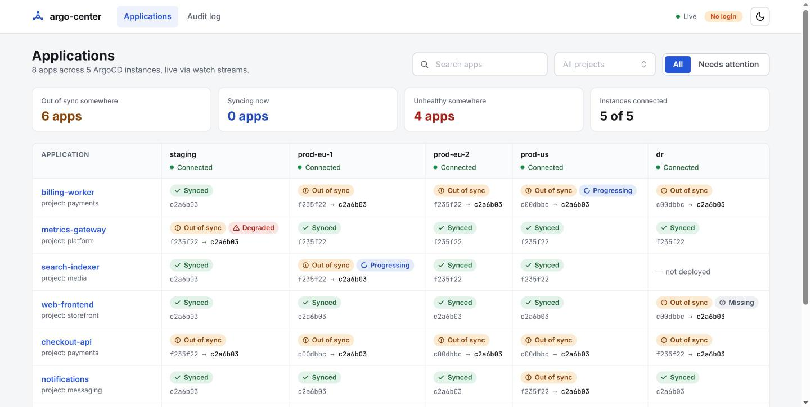
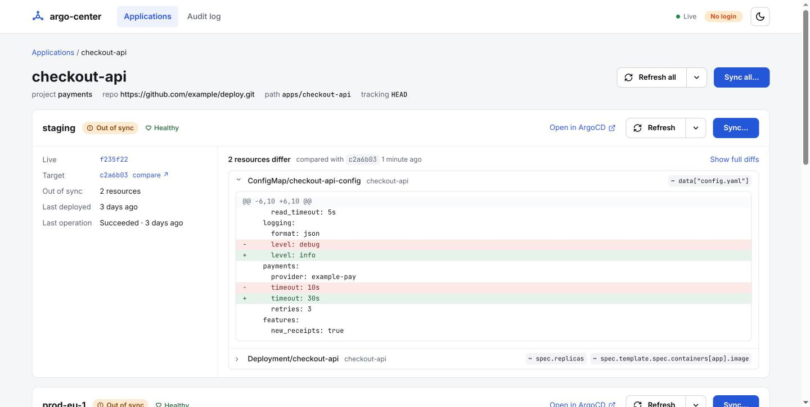
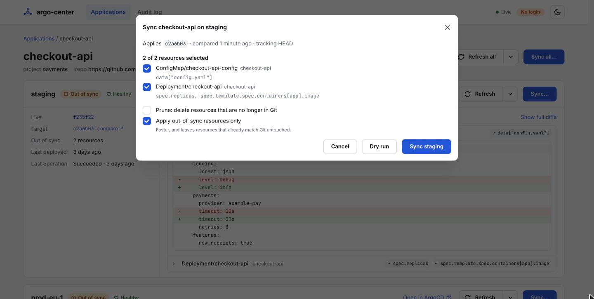
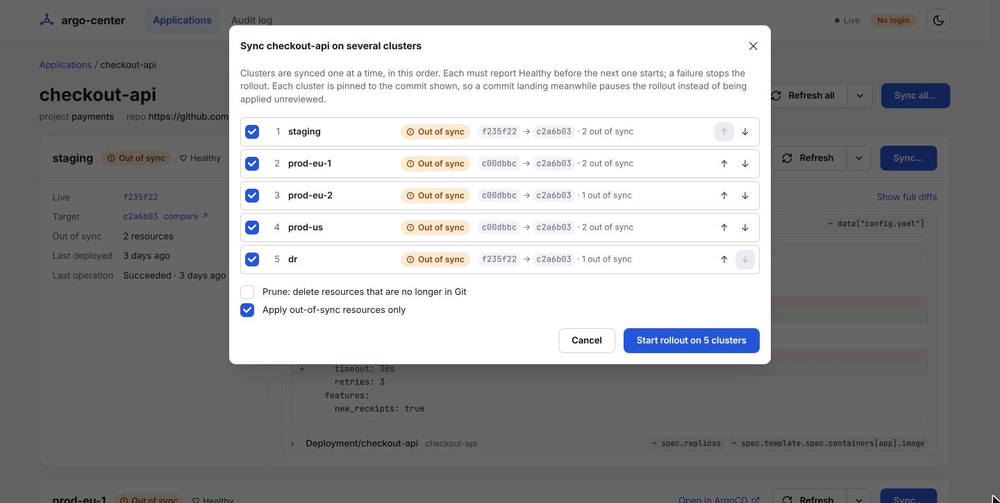
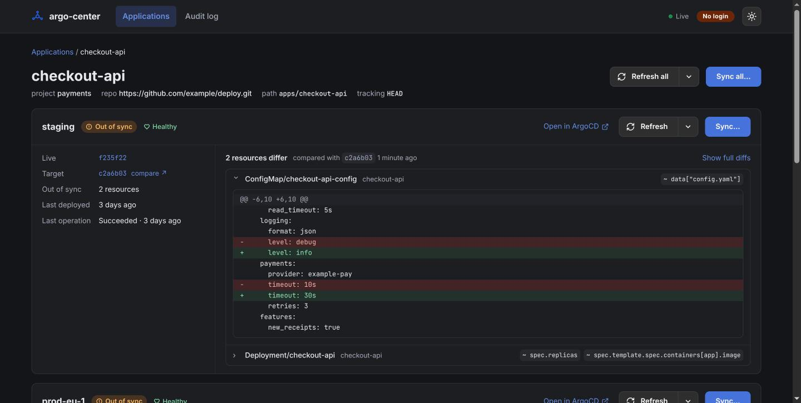

# argo-center

One panel for your applications across many ArgoCD instances.

If you run one ArgoCD per cluster and keep auto-sync off, syncing an app everywhere means a browser
tab per cluster. argo-center shows every app on every instance, gives a short diff per cluster, and
syncs one cluster or rolls out to several in order, from one screen. It keeps its own audit log of
who did what.

It assumes an app has the same name on every instance. It only needs an ArgoCD API token per
instance: no Kubernetes credentials and no changes to the clusters.

Design: [docs/design.md](docs/design.md). Open tasks: [docs/TODO.md](docs/TODO.md).

## Screenshots

**Overview.** Every app on every instance, with sync status, health and `live → target` commits per
cluster. "Needs attention" filters to apps that are out of sync or unhealthy anywhere.



**App page.** One card per cluster: what a sync would change (resources and changed fields), with
the full YAML diff on click.



**Sync one cluster.** Refreshes first, pins the commit you reviewed, and lets you pick resources,
prune and dry run.



**Sync all.** Plans an ordered rollout across clusters; each must be Healthy before the next starts.



**Dark mode.** The same app page; the moon/sun button in the header switches, starting from the
OS preference.



## Run locally

```sh
cp config.example.yaml config.yaml   # for local runs, replace the oidc block with insecureNoAuth: true
export ARGOCD_TOKEN_STAGING=...       # one per cluster, see tokenEnv in config.yaml

make web   # build the frontend once (embedded into the binary)
make run   # http://localhost:8080
```

For frontend work, keep `make run` going and start `make dev-web` (http://localhost:5173, hot reload, proxies `/api`).

## Deploy

Images are on `ghcr.io/snapp-incubator/argo-center`. See [deploy/README.md](deploy/README.md) for the
Helm chart in `deploy/helm/argo-center`.

## Tokens

On each ArgoCD instance, create a local account with API-key access and read/sync rights:

```yaml
# argocd-cm
accounts.argo-center: apiKey
# argocd-rbac-cm (policy.csv)
p, role:argo-center, applications, get, */*, allow
p, role:argo-center, applications, sync, */*, allow
g, argo-center, role:argo-center
```

Then `argocd account generate-token --account argo-center`.

## Login

Users log in through your OIDC provider (config `oidc`, `publicURL`, `sessionKeyEnv`; see
`config.example.yaml`). Register `<publicURL>/auth/callback` as the redirect URL of the client, and
`<publicURL>/auth/signed-out` as its post-logout redirect URL. Logging out also ends the session on
the provider. `oidc.allowedGroups` limits access to members of those groups. Without SSO (local
development), set `insecureNoAuth: true` instead: there is no login and actions are audited as user
`local`.

## Syncing and the audit log

**Sync…** on a cluster card refreshes that cluster first, then shows what will change. The sync is
pinned to the commit of that diff, so a commit landing in the meantime is not applied unreviewed
(except for apps with auto-sync on or several sources, where ArgoCD does not allow pinning; the
dialog says so). Options: prune, apply out-of-sync only, and a subset of resources. **Dry run** shows
its result in the dialog. A running operation can be terminated from the card.

Every sync, dry run, terminate and hard refresh is recorded in SQLite (`storage.sqlitePath`) and in
the JSON log, with the user, revision, options and ArgoCD's answer. The app page lists the latest
entries. "Accepted" means ArgoCD accepted the request; the outcome of the operation itself shows on
the cluster card.

## Rollouts (Sync all)

**Sync all…** on an app syncs it on several clusters, one after another, in the order you choose
(config order by default). Each cluster is refreshed, synced to the commit shown in the dialog, and
must report Healthy within `rollout.healthTimeout` (default 10 minutes) before the next one starts.
A failure stops the rollout; **Resume** retries from the failed cluster. If Git moved since the
rollout was planned, it pauses until someone confirms the new commit. **Abort** stops it, optionally
terminating the sync that is running. Rollouts run on the server: closing the tab does not stop
them, and everyone sees the same progress on the app page. If argo-center restarts mid-rollout, the
rollout shows as interrupted and can be resumed.

## Audit log and links

**Audit log** in the header lists everything done through argo-center (filter by app, cluster, user,
action). Filters, the overview's search and "Needs attention" view are all in the URL, so a view
can be shared as a link. Overview cells open the app page at that cluster's card
(`/apps/<name>#<cluster>`), and revisions link to their commit in GitHub or GitLab, with a "compare ↗" link from
the live to the target commit.

## How diffs work

- **No automatic refresh.** Opening an app does not ask ArgoCD to re-compare with Git; that would
  trigger refreshes on every instance on every page view. The diff comes from ArgoCD's latest
  comparison (the controller redoes it about every 3 minutes), and each cluster card shows how old it
  is and which revision it was compared with. Use **Refresh** (per cluster) or **Refresh all** to
  re-compare now, and **Hard refresh** to also regenerate manifests, skipping ArgoCD's cache.
- **Diffs reload only after a new comparison.** A diff is fetched again when the app's revision or
  reconcile time changes (for example after a refresh), not on every live update, since one app's
  `managed-resources` response can be several megabytes.
- **Large diffs are cut off.** Each resource lists at most 25 changed fields ("+N more" counts the
  rest), and its YAML diff is capped at 256 KB with a note saying so. Open the app in ArgoCD for the
  full diff.

## Layout

- `cmd/argo-center` — entry point
- `internal/config` — config file + token env vars
- `internal/argocd` — ArgoCD REST client
- `internal/cache` — list/watch per instance, in-memory state, change events
- `internal/diff` — brief (changed paths) and full (unified YAML) diffs from `managed-resources`
- `internal/auth` — OIDC login, session cookie, CSRF check
- `internal/audit` — audit log (SQLite)
- `internal/rollout` — multi-cluster rollout engine
- `internal/store` — SQLite connection shared by audit and rollouts
- `internal/api` — JSON API, SSE (`/api/events`), embedded SPA
- `web/` — React + Mantine frontend

## License

[Apache-2.0](LICENSE)
